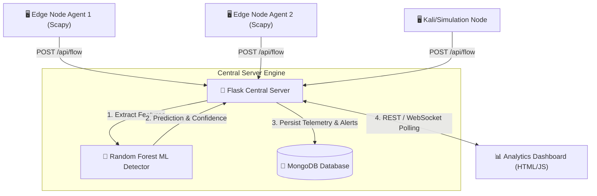

<div align="center">

# 🦅 GarudaRush

### **Intelligent, Real-Time DDoS Detection & Network Analysis System**

[](https://opensource.org/licenses/MIT)
[](https://www.python.org/)
[](https://flask.palletsprojects.com/)
[](https://www.mongodb.com/)
[](https://scapy.net/)
[](https://www.docker.com/)
[](https://github.com/rinwasourav/GarudaRush/actions)

---

**GarudaRush** is an end-to-end distributed network security ecosystem engineered for real-time network traffic sniffing, flow telemetry aggregation, and Machine Learning-powered DDoS attack detection.

[System Architecture](#-system-architecture) • [Features](#-key-features) • [Quickstart](#-getting-started) • [Docker Setup](#-docker-deployment) • [API Documentation](#-api-reference)

</div>

---

## ⚡ Overview

Modern distributed denial-of-service (DDoS) attacks are increasingly complex, multi-vector, and high-frequency. **GarudaRush** tackles this challenge by combining:
1. Lightweight, low-overhead distributed packet capture agents (**Traffic Miner**).
2. Centralized Flask ingestion backend storing structured telemetry into **MongoDB**.
3. High-precision **Random Forest Classifier** trained on high-dimensional flow features (packet rate, TCP SYN/ACK ratios, source IP entropy, ICMP spikes).
4. An interactive web-based **Analytics Dashboard** for live threat visualization.

---

## 🏗 System Architecture



---

## ✨ Key Features

- **🌐 Multi-Agent Distributed Sniffing**: Deploy edge agents across multiple hosts / network interfaces. Each agent auto-registers, sends health heartbeats, and tags telemetry with unique `agent_id`s.
- **🌲 ML Threat Detection**: Pre-trained Random Forest model evaluating flow windows in real-time, accurately identifying **SYN Floods**, **UDP Floods**, **ICMP Floods**, and **HTTP Request Floods**.
- **📈 Shannon Entropy Analysis**: Measures Source IP entropy per window—low entropy instantly alerts on botnets or IP-spoofed attack floods.
- **🛡 Authentication Middleware**: Support for secret API key header authentication (`X-API-Key`) across ingest and query endpoints.
- **⚡ Resilient Delivery Queue**: Edge agents buffer telemetry locally in a thread-safe queue during network partitions and retry automatically upon reconnect.
- **🐋 Production Docker Stack**: One-command orchestrator via `docker-compose` launching server and MongoDB with volume persistence.
- **📊 Real-time Monitoring Dashboard**: Web frontend serving live metrics, DDoS alert banners, throughput graphs, and agent health cards.

---

## 🚀 Getting Started

### Prerequisites

- **Python 3.8+**
- **MongoDB 7.0+** running locally or accessible over network (`mongodb://localhost:27017/`)
- Root / Administrator privileges on nodes running the packet sniffer agent (`agent.py`)

### 1. Clone Repository & Install Dependencies

```bash
git clone https://github.com/rinwasourav/GarudaRush.git
cd GarudaRush

python3 -m venv venv
source venv/bin/activate  # On Windows: venv\Scripts\activate
pip install -r requirements.txt
```

### 2. Launch MongoDB Database

```bash
# macOS (Homebrew)
brew services start mongodb/brew/mongodb-community@7.0

# Linux (systemd)
sudo systemctl start mongod
```

### 3. Run the Backend Server

```bash
python server.py
```
*The server will start listening at `http://localhost:5000` and automatically load the ML detection binaries (`ddos_rf_model.pkl` & `ddos_scaler.pkl`).*

### 4. Open Analytics Dashboard

Open your web browser and navigate to:
```text
http://localhost:5000
```

### 5. Launch Traffic Miner Agent

On network interfaces you want to monitor (*requires root privileges for raw socket sniffing*):

```bash
sudo SERVER_URL="http://localhost:5000" INTERFACE="eth0" python agent.py
```

---

## 🧪 Simulation Engine

To test and validate the detection pipeline without launching actual attack tools:

```bash
python simulate_flows.py
```

This injects synthetic **Normal Traffic**, **SYN Flood**, **ICMP Flood**, and **HTTP Flood** vectors into the running server and verifies live prediction responses.

---

## 🐋 Docker Deployment

Launch the complete stack (Flask Server + MongoDB Database) with Docker Compose:

```bash
# Build and start services in detached mode
docker-compose -f docker/docker-compose.yml up -d --build

# View container logs
docker-compose -f docker/docker-compose.yml logs -f
```

---

## 📡 API Reference

| Method | Endpoint | Description | Auth Required |
| :--- | :--- | :--- | :---: |
| `GET` | `/` | Serves the frontend monitoring dashboard UI | No |
| `GET` | `/api/health` | Health & readiness probe (DB status, ML state, online agents) | No |
| `POST` | `/api/agents/register` | Auto-registers a new distributed agent node | Yes (if configured) |
| `POST` | `/api/agents/heartbeat` | Agent liveness ping update | Yes (if configured) |
| `GET` | `/api/agents` | Lists registered agents with online state & threat levels | Yes (if configured) |
| `POST` | `/api/flow` | Ingests a packet telemetry window & triggers ML inference | Yes (if configured) |
| `GET` | `/api/flows` | Returns paginated network flow history | Yes (if configured) |
| `GET` | `/api/alerts` | Fetches recent detected DDoS attack alerts | Yes (if configured) |
| `GET` | `/api/stats` | Aggregated traffic stats & attack breakdown by vector | Yes (if configured) |
| `GET` | `/api/flows/export` | Downloads flow history as a structured `.csv` file | Yes (if configured) |

---

## 🧪 Automated Testing

Run the unit and integration test suite:

```bash
python3 -m unittest discover -s tests -p "test_suite.py"
```

---

## 📁 Repository Structure

```
GarudaRush/
├── .github/
│   ├── workflows/ci.yml         # GitHub Actions CI automation pipeline
│   ├── ISSUE_TEMPLATE/          # Bug & feature report templates
│   └── PULL_REQUEST_TEMPLATE.md # PR guidelines template
├── docs/
│   ├── DATASET.md               # Dataset download & synthetic generator guide
│   ├── diagrams/                # System architecture, class, DFD & sequence diagrams
│   └── presentation/            # Capstone project report & presentation materials
├── docker/
│   ├── Dockerfile               # Multi-stage container specification
│   └── docker-compose.yml       # Server + MongoDB stack setup
├── src/
│   ├── agent/agent.py           # Scapy packet sniffer and feature aggregator
│   ├── server/server.py         # Flask REST API server & MongoDB ingest engine
│   ├── server/dashboard.html    # Interactive real-time dashboard UI
│   ├── model/ml_model.py        # Random Forest model trainer & DDoS Detector
│   └── utils/simulate_flows.py  # Traffic attack vector simulation engine
├── tests/
│   └── test_suite.py            # PyTest / Unittest automated suite
├── agent.py                     # Root agent launcher
├── server.py                    # Root server launcher
├── ml_model.py                  # Root ML model trainer launcher
├── simulate_flows.py            # Root flow simulator launcher
├── requirements.txt             # Pinned dependency requirements
├── setup.py                     # Setuptools package configuration
├── LICENSE                      # MIT Open Source License
└── README.md                    # Project documentation
```

---

## 🛡 Security & Disclaimer

*GarudaRush is built for research, educational, and network defense purposes under the Capstone framework. Always obtain authorization prior to capturing packet telemetry or monitoring network flows.*

## 📜 License

This project is licensed under the **MIT License** - see the [LICENSE](LICENSE) file for details.
